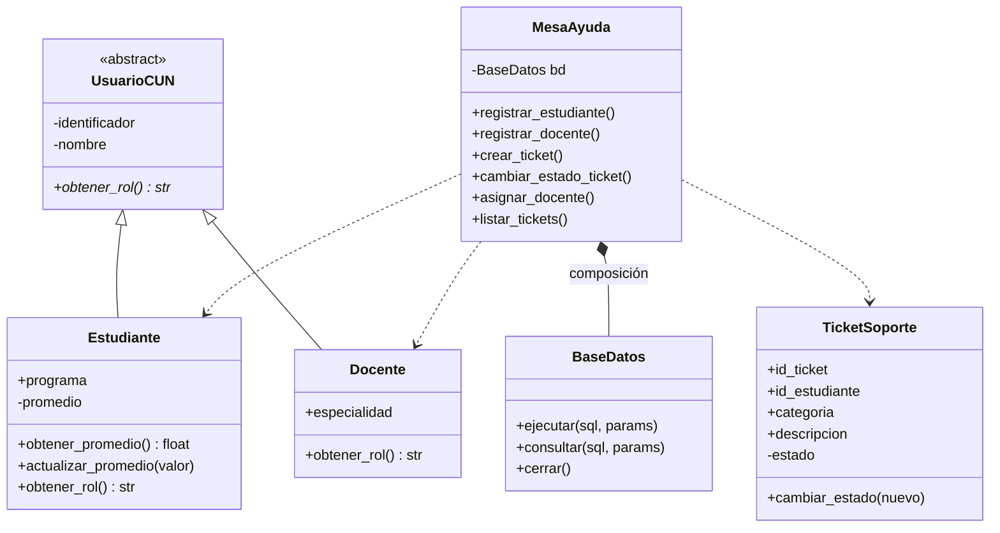
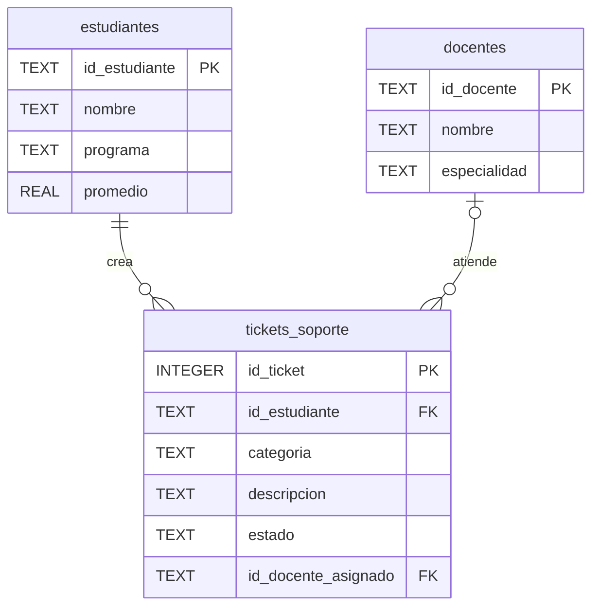

# 🎓 Mesa de Ayuda TI y Gestión Académica – CUN

Taller práctico integrador de **Programación Orientada a Objetos (POO)**
Corporación Unificada Nacional de Educación Superior (CUN) · Ingeniería de Sistemas

Aplicación de escritorio desarrollada en **Python**, con interfaz **Tkinter** y base de datos relacional **SQLite**, que automatiza la atención de solicitudes técnicas (tickets de soporte TI) y la gestión de estudiantes y docentes.

---

## 📌 Contexto del caso

La Mesa de Ayuda de TI y Gestión Académica de la CUN necesita automatizar la atención de solicitudes técnicas y la asignación de aulas. El sistema gestiona tres entidades principales: **Estudiantes**, **Docentes** y **Tickets de Soporte TI**.

## 🎯 Objetivos del taller

1. Diseñar el modelo de clases en Python aplicando encapsulamiento, herencia y composición.
2. Crear un script en Python que construya la base de datos SQLite `cun_sistema.db`.
3. Conectar la lógica POO con la base de datos para insertar y consultar registros.
4. Subir el proyecto terminado a GitHub.

## ✨ Funcionalidades

| Módulo | Qué permite hacer |
|---|---|
| **Estudiantes** | Registrar, consultar, actualizar el promedio (0.0 – 5.0) y eliminar |
| **Docentes** | Registrar, consultar y eliminar |
| **Tickets de soporte** | Crear tickets, filtrarlos por estado, avanzar su estado (`ABIERTO → EN_PROCESO → CERRADO`) y asignarles un docente |
| **Resumen** | Contadores en la parte superior de la ventana (estudiantes, docentes y tickets por estado) |
| **Datos de ejemplo** | Menú *Archivo → Cargar datos de ejemplo* para probar rápidamente |

Todas las operaciones validan los datos y muestran mensajes de error claros (por ejemplo, un promedio de 6.0 o un ticket sin descripción).

## 🧠 Conceptos de POO aplicados

| Concepto | Implementación |
|---|---|
| **Encapsulamiento** | Atributos privados `__promedio`, `__estado`, `__nombre`, `__identificador`, accedidos con propiedades y métodos que validan |
| **Herencia** | `Estudiante` y `Docente` heredan de `UsuarioCUN` usando `super().__init__()` |
| **Polimorfismo** | Cada subclase implementa `obtener_rol()` con su propia lógica |
| **Abstracción** | `UsuarioCUN` es una clase abstracta (`ABC`, `@abstractmethod`) |
| **Composición** | `MesaAyuda` *tiene un* `BaseDatos` que crea y cierra ella misma |
| **Manejo de excepciones** | `try/except` con `ValueError` y `sqlite3.Error`; los errores se muestran al usuario en ventanas |

### Diagrama de clases



## 🗄️ Modelo de base de datos (`cun_sistema.db`)



Las tablas `estudiantes` y `tickets_soporte` siguen la estructura solicitada en la guía; se añadió la tabla `docentes` y la columna opcional `id_docente_asignado` para conectar las tres entidades del caso.

## 📁 Estructura del proyecto

```
proyecto_poo_cun/
├── main.py            # Clases POO, lógica de negocio e interfaz gráfica
├── crear_bd.py        # Script que construye la base de datos cun_sistema.db
├── cun_sistema.db     # Base de datos SQLite generada por el script
├── build_exe.bat      # Genera el ejecutable MesaAyudaCUN.exe (PyInstaller)
├── requirements.txt   # Dependencia solo para crear el .exe
├── .gitignore
└── README.md
```

## ⚙️ Requisitos

- **Python 3.10 o superior** (con Tkinter, incluido en el instalador oficial de Windows).
- No se necesitan librerías externas para ejecutar la app: solo se usan `tkinter`, `sqlite3`, `abc`, `os` y `sys`.
- **PyInstaller** únicamente si quieres generar el `.exe`.

## ▶️ Cómo ejecutarlo

### Opción 1: con Python
```bash
git clone https://github.com/TU_USUARIO/NOMBRE_DEL_REPOSITORIO.git
cd NOMBRE_DEL_REPOSITORIO
python main.py
```

### Opción 2: como ejecutable `.exe` (Windows)
1. Haz doble clic en `build_exe.bat` (o ejecútalo desde la consola).
2. El resultado queda en `dist/MesaAyudaCUN.exe`, con su base de datos al lado.

> La base de datos se crea o se usa siempre en la misma carpeta donde está `main.py` o el `.exe`.

### Regenerar la base de datos desde cero
```bash
python crear_bd.py
```

## 🧪 Ejemplo de uso rápido

1. Abre la app y ve a **Archivo → Cargar datos de ejemplo**.
2. En **Tickets de soporte TI**, selecciona un estudiante, una categoría y escribe la descripción; pulsa **Crear ticket**.
3. Selecciona el ticket en la tabla, elige **EN_PROCESO** y pulsa **Cambiar estado**.
4. Elige un docente y pulsa **Asignar docente**.

Reglas del negocio: un ticket solo puede avanzar de estado y, una vez `CERRADO`, ya no se modifica ni se le asigna docente.

## 📦 Entregables del taller

- [x] Código Python (`main.py`) con clases `Estudiante` y `TicketSoporte`, encapsulamiento y conexión a la BD.
- [x] Base de datos `cun_sistema.db` generada con `crear_bd.py`.
- [x] Repositorio público en GitHub con este `README.md`.

## 👤 Autor

- **Nombre:** Jose Santiago Paez Reyes
- **Programa:** Ingeniería de Sistemas – CUN
- **Asignatura:** Programación Orientada a Objetos

